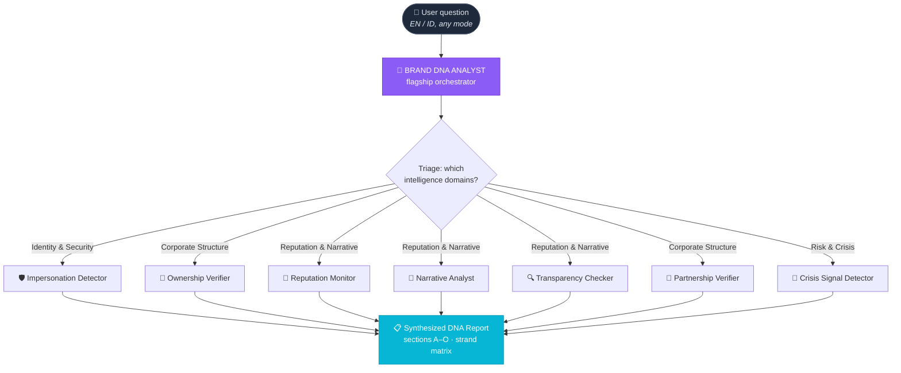

<div align="center">

# 🧬 BRAND DNA ANALYST — Skill Ecosystem

### *The Brand & Reputation Intelligence Family*

<br>

**Evidence first. Suspicion second. Protection always.**

One flagship orchestrator. Seven specialist investigators.
Eight evidence strands. One synthesized intelligence picture.

<br>


</div>

---

## 🧬 What This Ecosystem Is

Brand & reputation questions look simple — *"is this real?"*, *"is this brand trustworthy?"*,
*"did they really partner with X?"* — but answering them honestly requires
**cross-domain OSINT**: corporate registries, DNS records, review platforms,
press archives, social graphs, filing databases.

This repo packages that workflow as **8 installable agent skills** built on the
**VANTAGE INTELLIGENCE Category-13 architecture**:

- **Evidence-first** — every claim graded, every source tiered
- **Suspect-aware** — lookalikes, astroturf, shell entities, narrative manipulation
- **Protection-oriented** — consumers, investors, journalists, and risk teams get
  lawful, proportionate, defensible outputs

---

## 🏛️ The Ecosystem

```
                 ┌─────────────────────────────────────────┐
                 │      🧬 BRAND DNA ANALYST (flagship)      │
                 │   8-strand investigation · 10-step       │
                 │   protocol · triage & synthesis          │
                 └──────────────────┬──────────────────────┘
                                    │ routes & synthesizes
        ┌───────────────┬───────────┼───────────┬───────────────┐
        ▼               ▼           ▼           ▼               ▼
   🛡️ IDENTITY      🏢 CORPORATE   📣 REPUTATION  🚨 RISK &
   & SECURITY       STRUCTURE     & NARRATIVE    CRISIS
   ───────────      ──────────    ───────────    ────────────
   Impersonation    Ownership     Reputation     Crisis Signal
   Detector         Verifier      Monitor        Detector
        │               │           │               │
   (lookalikes,    (registry     (reviews,      (controversy,
    fake accounts,  chains,       astroturf,     escalation,
    typosquats,     shell flags)   complaints,    recovery)
    phishing)                  Narrative Analyst
                                 Transparency     Partnership
                                 Checker          Verifier
```



---

## 📚 Skill Catalog

| # | Skill | Path | Purpose | Best for |
|---|---|---|---|---|
| 1 | **Brand DNA Analyst** *(flagship)* | [`SKILL.md`](SKILL.md) | Full 8-strand brand investigation — entity, domain, identity, claims, voice, reputation, network, trajectory | Anyone needing the complete picture |
| 2 | **Impersonation Detector** | [`skills/brand-impersonation-detector/SKILL.md`](skills/brand-impersonation-detector/SKILL.md) | Lookalike & typosquat domains, fake social accounts, logo misuse, phishing-adjacent signals, fake apps | Brand-protection teams, consumers, trust & safety |
| 3 | **Ownership Verifier** | [`skills/brand-ownership-verifier/SKILL.md`](skills/brand-ownership-verifier/SKILL.md) | Registry chains, parent/subsidiary mapping, registered agents, address consistency, leadership history, shell-entity flags | Investors, journalists, procurement, due diligence |
| 4 | **Partnership Verifier** | [`skills/brand-partnership-verifier/SKILL.md`](skills/brand-partnership-verifier/SKILL.md) | Audits claimed partnerships, sponsorships, certifications (incl. ISO via cert registries), endorsements, supplier claims | Marketing teams, journalists, consumers |
| 5 | **Reputation Monitor** | [`skills/brand-reputation-monitor/SKILL.md`](skills/brand-reputation-monitor/SKILL.md) | Review-pattern analysis, astroturf detection, complaint clustering, crisis early-warning, sentiment trajectory | PR teams, community managers, risk analysts |
| 6 | **Narrative Analyst** | [`skills/brand-narrative-analyst/SKILL.md`](skills/brand-narrative-analyst/SKILL.md) | Statement contradictions, press-release verification, narrative-evolution timeline, claim-vs-evidence gaps | Investigative journalists, researchers, analysts |
| 7 | **Transparency Checker** | [`skills/brand-transparency-checker/SKILL.md`](skills/brand-transparency-checker/SKILL.md) | Disclosed vs. actual information, opacity red flags, filing completeness, claims substantiation | Regulators, NGOs, investors, watchdogs |
| 8 | **Crisis Signal Detector** | [`skills/brand-crisis-signal-detector/SKILL.md`](skills/brand-crisis-signal-detector/SKILL.md) | Controversy timelines, escalation-signal taxonomy, media-narrative shifts, apology effectiveness, recovery tracking | Crisis comms, executives, media monitors |

<details>
<summary><b>🧩 Capability chips per skill</b></summary>

<br>

**🧬 Brand DNA Analyst** — `8 DNA strands` `10-step protocol` `5-tier sources` `A–O report` `3 modes`

**🛡️ Impersonation Detector** — `typosquat detection` `handle squatting` `logo misuse` `phishing-adjacent signals` `fake app stores`

**🏢 Ownership Verifier** — `registry chain tracing` `UBO mapping` `registered agent analysis` `address consistency` `shell-entity heuristics`

**🤝 Partnership Verifier** — `partnership claim audit` `cert-registry checks (ISO)` `endorsement verification` `supplier claims` `evidence grading`

**📣 Reputation Monitor** — `review pattern analysis` `astroturf detection` `complaint clustering` `sentiment trajectory` `crisis early-warning`

**📖 Narrative Analyst** — `contradiction detection` `press-release verification` `narrative timeline` `claim-vs-evidence gap` `statement sourcing`

**🔍 Transparency Checker** — `disclosure completeness` `opacity scoring` `filing cross-check` `claims substantiation` `governance signals`

**🚨 Crisis Signal Detector** — `controversy timelines` `escalation taxonomy` `narrative-shift detection` `apology effectiveness` `recovery tracking`

</details>

---

## 🔄 How They Work Together

```
You ask ──► Flagship triages ──► Specialists deep-dive ──► Synthesized report
   │              │                    │                        │
   │   "Is this brand legit?"           │                        │
   │        ▼                           ▼                        ▼
   │   Which strands?            Ownership + Domain +     DNA Report:
   │   Reputation? Claims?       Reputation + Narrative   verdict ·
   │   Crisis? Partners?         + Crisis signals         confidence ·
   │                             (as relevant)            strand matrix
```

1. **Triage** — the flagship maps your question onto the 8 DNA strands and
   decides which specialists (if any) to invoke.
2. **Deep-dives** — specialists run their focused protocols with the same
   shared evidence standards.
3. **Synthesis** — findings merge into one evidence-graded report; nothing
   is averaged away — correlated strands, contradictory evidence surfaced.

You can also invoke any specialist **directly** when you already know the
question (e.g., *"audit this ISO certificate"* → Partnership Verifier).

---

## 📐 Shared Standards — Every Skill, Same Discipline

### Evidence tiers

| Tier | Class | Examples | Rule |
|---|---|---|---|
| **T1** | Primary official | Registries, filings, trademark DBs, corporate disclosures, cert registries | Can support `VERIFIED` |
| **T2** | Independent authoritative | Government records, official partner announcements | `SUPPORTED` |
| **T3** | Reputable secondary | Established news, industry reports | `SUPPORTED` (corroboration needed for `VERIFIED`) |
| **T4** | Community signal | Reviews, forums, public social | Context only — never established fact |
| **T5** | Unverified leads | Aggregators, anonymous claims | Leads only — must be re-verified upward |

### Evidence labels & confidence

```
VERIFIED ──► SUPPORTED ──► UNVERIFIED_CLAIM ──► INTERPRETATION ──► UNKNOWN
                confidence: HIGH · MEDIUM · LOW · INSUFFICIENT
```

### The 10-step protocol

```
UNDERSTAND → DEFINE → DISCOVER → COLLECT → VERIFY → CORRELATE
→ ANALYZE → ASSESS → REPORT → RECOMMEND
```

### Safety rules — non-negotiable

✅ Lawful public information only · ✅ No doxxing or auth bypass ·
✅ No fabricated allegations · ✅ No "fraud"/"scam" labels below the evidence bar ·
✅ No criminality inferred from reputation signals alone · ✅
Missing records ≠ proof of absence · Associations ≠ proof of misconduct ·
Private individuals → public professional information only

*Every skill enforces these; if a request crosses the line, the skill declines
the prohibited part and offers the lawful alternative.*

---

## 🚀 Quick Start

Ask in natural language — **English or Bahasa Indonesia**:

```text
# English
"Is this website real? I'm about to buy from them."
"Investigate this company's reputation."
"Does Brand X really partner with Brand Y?"
"Verify this seller before I order."
"Is there a fake account impersonating this brand?"
"Track this brand's reputation over 3 years."
"Is this company actually owned by X?"
"Is this controversy escalating?"

# Bahasa Indonesia
"Apakah brand ini asli atau palsu?"
"Cek keaslian website perusahaan ini."
"Verifikasi kerja sama Brand X dan Brand Y."
"Apakah ada akun palsu meniru brand ini?"
"Pantau reputasi brand ini selama 3 tahun."
"Siapa pemilik sebenarnya perusahaan ini?"
"Apakah kontroversi ini sedang membesar?"
```

Each skill also ships a **report template (sections A–O)** and a
**100-point quality scorecard** so outputs stay consistent and auditable.

---

## 📂 Repository Structure

```
Brand-DNA-Analyst/
├── SKILL.md                                  ← flagship orchestrator
├── README.md                                 ← this file
└── skills/
    ├── brand-impersonation-detector/
    │   └── SKILL.md                          ← lookalikes, fakes, phishing signals
    ├── brand-ownership-verifier/
    │   └── SKILL.md                          ← registry chains, shell flags
    ├── brand-partnership-verifier/
    │   └── SKILL.md                          ← partnerships, certs, endorsements
    ├── brand-reputation-monitor/
    │   └── SKILL.md                          ← reviews, astroturf, sentiment
    ├── brand-narrative-analyst/
    │   └── SKILL.md                          ← contradictions, timelines
    ├── brand-transparency-checker/
    │   └── SKILL.md                          ← disclosed vs. actual
    └── brand-crisis-signal-detector/
        └── SKILL.md                          ← controversies, escalation
```

Each `SKILL.md` is a **self-contained, agent-ready skill** — drop it into your
agent's skills directory or reference it from your plugin manifest.

---

## 🎯 Modes & Languages

| Mode | For | Output |
|---|---|---|
| 🌱 **BEGINNER** | Consumers, first-time investigators | Plain language, "bottom line" + next steps |
| ⚙️ **PROFESSIONAL** | Analysts, PR, corporate teams | Structured methodology, risk matrix, confidence grades |
| 🧠 **EXPERT** | Investigators, researchers | Multi-source correlation, hypothesis testing, strand matrix |

🌐 **Languages:** English + Bahasa Indonesia (full trigger & reporting support in both)

---

## 📊 Quality Scorecard

Every investigation is scored on a **100-point scorecard** covering:

- **Source discipline** (tier usage, T1/T2 reliance)
- **Evidence hygiene** (labels applied, contradictions surfaced, gaps declared)
- **Correlation** (cross-strand consistency checks)
- **Calibration** (confidence matches evidence strength)
- **Safety compliance** (prohibited conduct avoided, lawful alternatives offered)
- **Report completeness** (A–O sections, actionable recommendations)

A report below threshold is returned for refinement — never shipped as "done".

---

## 🇮🇩 Ringkasan Bahasa Indonesia

<div dir="rtl" align="right">

### 🧬 Apa Ini?

**Brand DNA Analyst** adalah ekosistem **8 skill agen** untuk investigasi
merek & reputasi berbasis bukti (OSINT). Satu skill utama (*flagship*) mengorkestrasi
tujuh spesialis: deteksi impersonasi, verifikasi kepemilikan, verifikasi
kemitraan, monitor reputasi, analisis narasi, cek transparansi, dan deteksi
sinyal krisis.

**Prinsip inti:** *Evidence first. Suspicion second. Protection always.* —
setiap temuan diberi label bukti (`VERIFIED` → `UNKNOWN`) dan tingkat
kepercayaan (`HIGH` → `INSUFFICIENT`). Sumber dibagi 5 tier (T1 resmi →
T5 belum terverifikasi).

### 📚 Katalog (ringkas)

| Skill | Fungsi |
|---|---|
| 🧬 DNA Analyst | Investigasi merek menyeluruh — 8 strand DNA |
| 🛡️ Impersonation Detector | Domain palsu, akun tiruan, penyalahgunaan logo |
| 🏢 Ownership Verifier | Rantai kepemilikan, entitas shell, registrasi |
| 🤝 Partnership Verifier | Audit klaim partnership, sertifikasi, endorsement |
| 📣 Reputation Monitor | Pola ulasan, astroturf, peringatan dini krisis |
| 📖 Narrative Analyst | Kontradiksi pernyataan, verifikasi press release |
| 🔍 Transparency Checker | Informasi disclosed vs. aktual, transparansi |
| 🚨 Crisis Signal Detector | Linimasa kontroversi, eskalasi, efektivitas apology |

### 🚀 Cara Pakai

Tulis pertanyaan dalam bahasa natural (Indonesia/Inggris), misalnya:

```text
"Apakah brand ini asli atau palsu?"
"Verifikasi kerja sama Brand X dan Brand Y."
"Apakah ada akun palsu meniru brand ini?"
"Pantau reputasi brand ini selama 3 tahun."
```

### 📐 Standar Bukti

- **5 tier sumber:** T1 resmi → T5 belum terverifikasi (T4–T5 tak pernah
  dianggap fakta)
- **Label bukti:** `VERIFIED` · `SUPPORTED` · `UNVERIFIED_CLAIM` ·
  `INTERPRETATION` · `UNKNOWN`
- **Protokol 10 langkah:** Understand → Define → Discover → Collect →
  Verify → Correlate → Analyze → Assess → Report → Recommend
- **Aturan keamanan:** hanya info publik legal; tanpa doxxing; tanpa tuduhan
  fabrikasi; label "fraud" dilarang tanpa bukti memadai

### 📜 Lisensi

MIT © 2026 **Adhithya Pranandra Soemitro / VeryCoolApps**

</div>

---

## 📜 License

MIT © 2026 **Adhithya Pranandra Soemitro / VeryCoolApps**

---

<div align="center">

### 🧬 BRAND DNA ANALYST — Skill Ecosystem

*Built on the VANTAGE INTELLIGENCE Category-13 architecture.*

**Evidence first. Trust always. Intelligence without boundaries of imagination.**

<br>

`EVIDENCE → FINDINGS → CONFIDENCE → PROTECTION`

</div>
