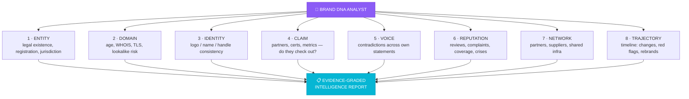

<div align="center">

# 🧬 BRAND DNA ANALYST

### *The Brand & Reputation OSINT Intelligence Engine*

<br>

**Evidence first. Suspicion second. Protection always.**

A brand's DNA is not its logo — it is the **verifiable chain of evidence**
behind every claim it makes: who owns it, what it registers, what it
promises, what others say, and whether the story holds together.

**BRAND DNA ANALYST** reconstructs that chain.
It does not trust appearances. It cross-checks them.

<br>


</div>

---

## ⚡ What It Does

| 🔍 Verify | 🕵️ Detect | 🧬 Map | 📊 Assess |
|---|---|---|---|
| Brand authenticity | Impersonation & lookalikes | Ownership chains | Reputation signals |
| Website legitimacy | Fake accounts & domains | Partnerships & claims | Review patterns |
| Entity existence | Copycat & logo misuse | Affiliations | Crisis early-warnings |
| Claimed credentials | Typosquatting | Executive footprint | Consumer trust risk |

Every finding is graded:

```
VERIFIED  →  SUPPORTED  →  UNVERIFIED  →  INTERPRETATION  →  UNKNOWN
     └────────── confidence: HIGH · MEDIUM · LOW · INSUFFICIENT ──────────┘
```

---

## 🧬 The Eight DNA Strands

Every investigation is scored across eight evidence strands — correlated,
never averaged:



---

## 🔄 The 10-Step Investigation Protocol

```
UNDERSTAND → DEFINE → DISCOVER → COLLECT → VERIFY → CORRELATE → ANALYZE → ASSESS → REPORT → RECOMMEND
```

Golden rules — always enforced:

> 🔸 A search result is not proof.
> 🔸 A social post is not automatically authentic.
> 🔸 A complaint is not automatically evidence of wrongdoing.
> 🔸 A missing record is not proof something does not exist.
> 🔸 An association is not proof of misconduct.

---

## 🛡️ Source Hierarchy

| Tier | Class | Trust |
|---|---|---|
| **T1** | Primary official — registries, filings, trademark DBs, corporate disclosures | ██████ Highest |
| **T2** | Independent authoritative — government records, official partner announcements | █████ High |
| **T3** | Reputable secondary — established news, industry reports | ████ Medium |
| **T4** | Community signal — reviews, forums, public social | ██ Low–Med |
| **T5** | Unverified leads — aggregators, anonymous claims | █ Lead only |

*Tiers 4–5 are never presented as established fact.*

---

## 🎯 Who It's For

<div align="center">

| 🛒 Consumers | 🚀 Founders | 📣 Marketers | 📰 Journalists | 🔬 Researchers | 🏢 Corporates |
|---|---|---|---|---|---|
| Check before you buy | Due-diligence partners | Vet brand safety | Verify claims before publishing | Structured OSINT study | Third-party risk |

| 🤝 PR Teams | 🧑‍💼 Recruiters | 🏪 E-commerce | 🌍 NGOs | 🎓 Educators | 🕵️ Investigators |
|---|---|---|---|---|---|
| Reputation monitoring | Verify company legitimacy | Seller authenticity | Charity transparency | Media literacy | Case-grade reports |

</div>

---

## 🧠 Three Modes, One Engine

<table>
<tr><th>Mode</th><th>Experience</th><th>Output</th></tr>
<tr>
<td><b>🌱 BEGINNER</b></td>
<td>Plain language, guided steps, jargon translated</td>
<td>"Bottom line" box + what-to-do-next</td>
</tr>
<tr>
<td><b>⚙️ PROFESSIONAL</b></td>
<td>Structured methodology, source tiers, evidence tables</td>
<td>Risk matrix + confidence grades</td>
</tr>
<tr>
<td><b>🧠 EXPERT</b></td>
<td>Multi-source correlation, hypothesis testing, falsification</td>
<td>Timeline reconstruction + strand matrix</td>
</tr>
</table>

---

## 📦 Report Architecture

```markdown
# BRAND DNA REPORT — <subject>

## A. EXECUTIVE SUMMARY          ← verdict + confidence
## B. INVESTIGATION OBJECTIVE
## C. SUBJECT IDENTIFICATION     ← entities, domains, jurisdiction
## D. SCOPE & LIMITATIONS
## E. SOURCE REGISTER            ← every source, tier, date
## F. VERIFIED FINDINGS
## G. SUPPORTING EVIDENCE
## H. CONTRADICTORY EVIDENCE     ← never hidden
## I. ANALYTICAL OBSERVATIONS    ← the 8 DNA strands
## J. RISK ASSESSMENT            ← Low → Severe
## K. CONFIDENCE LEVEL           ← HIGH / MEDIUM / LOW / INSUFFICIENT
## L. INFORMATION GAPS           ← honest unknowns
## M. RECOMMENDED ACTIONS        ← lawful & proportionate
## N. INVESTIGATION TIMELINE
## O. DISCLAIMERS
```

---

## 🔐 Safety & Ethics — Non-Negotiable

✅ Lawful public information only · ✅ No auth bypass · ✅ No doxxing ·
✅ No fabricated allegations · ✅ No "fraud" labels without the evidence bar ·
✅ No criminality inferred from reputation signals · ✅ Uncertainty
communicated explicitly · ✅ Private individuals → public professional
information only

*If a request crosses the line: decline the prohibited part, offer the lawful
alternative, explain why.*

---

## 🚀 Quick Start

Ask in natural language — English or Indonesian:

```text
"Is this website real? I'm about to buy from them."
"Apakah brand ini asli atau palsu?"
"Investigate this company's reputation."
"Does Brand X really partner with Brand Y?"
"Verify this seller before I order."
"Track this brand's reputation over 3 years."
"Is there a fake account impersonating this brand?"
"Cek keaslian website perusahaan ini."
```

---

## 📂 Repository Structure

```
Brand-DNA-Analyst/
├── SKILL.md          ← the complete intelligence skill (agent-ready)
└── README.md         ← this file
```

`SKILL.md` is a self-contained, production-grade skill compatible with
AI skill/plugin environments — install by dropping it into your agent's
skills directory or referencing it from your plugin manifest.

---

## 🧬 Category 13 Family

BRAND DNA ANALYST is the **flagship orchestrator** of the Brand &
Reputation Intelligence ecosystem. Specialized sibling capabilities it can
delegate to:

| Sibling | Handles |
|---|---|
| Brand Impersonation Detector | Lookalike domains, fake accounts, logo misuse |
| Ownership Verifier | Registry chains, parent/subsidiary mapping |
| Partnership Verifier | Affiliations, sponsorships, endorsements |
| Reputation Monitor | Review patterns, complaints, crisis signals |
| Narrative Analyzer | Statement contradictions, timelines |
| Transparency Checker | Disclosed vs. actual information |

---

## 📜 License

MIT © 2026 **Adhithya Pranandra Soemitro / VeryCoolApps**

---

<div align="center">

### 🧬 BRAND DNA ANALYST

*Built on the VANTAGE INTELLIGENCE Category-13 architecture.*

**Evidence first. Trust always. Intelligence without boundaries of imagination.**

<br>

`EVIDENCE → FINDINGS → CONFIDENCE → PROTECTION`

</div>
